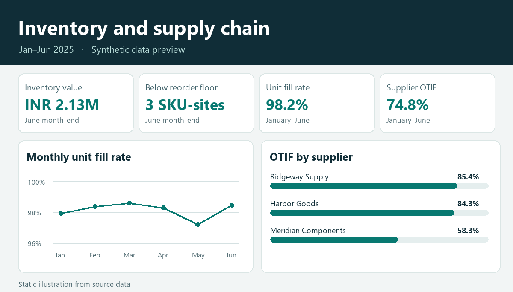

# Power BI inventory and supply chain dashboard

An inventory and supplier performance report for a fictional retail network. It covers eight SKUs, four warehouses and six months. The project uses synthetic records generated with a fixed random seed.

The image summarizes the synthetic data independently of Power BI. Open the Power BI project for the report pages and filters.

## Findings from the sample

| Metric | Result | Reporting basis |
|---|---:|---|
| Inventory value | INR 2,127,870 | June month-end |
| On-hand units | 5,394 | June month-end |
| SKU-site positions below reorder floor | 3 | June month-end |
| Unit fill rate | 98.2% | January–June |
| Unfilled units | 1,102 | January–June |
| Supplier OTIF | 74.8% | January–June, 576 due PO lines |

Select June and East on **Inventory and service** to see the electronics inventory exceptions. Use **Supplier performance** to compare late lines and OTIF by supplier before following up with purchasing.

## Open and verify

1. Download or clone the entire repository and open `Inventory.pbip` in a current Windows release of Power BI Desktop that supports the [Power BI project format](https://learn.microsoft.com/en-us/power-bi/developer/projects/projects-overview).
2. Select **Refresh** to load the embedded Power Query tables. The project requires no credentials or absolute file paths. Keep both item folders next to the project file.
3. Clear the report's filters and reconcile the cards against [baseline_metrics.json](baseline_metrics.json). Test June on both pages and compare the inventory exceptions by SKU and warehouse. Save as a PBIX if you need a single-file copy.
4. To regenerate the project and data, close Power BI Desktop and run `python build.py` with Python 3.10+. The generator rewrites the report definitions and CSVs. Run it before making hand edits you intend to keep.

The generator checks record grain, quantity bounds, the OTIF rule and references from report visuals to model fields. The shipped report source still needs an open, refresh and visual check in Power BI Desktop.

## Model and measures

| Table | Grain | Use |
|---|---|---|
| Inventory | Month × warehouse × SKU | End-of-month on-hand quantity, cost and reorder threshold |
| Demand | Month × warehouse × SKU | Ordered and filled units |
| Receipts | One synthetic due PO line | Supplier, quantities, late and OTIF status |
| Month, Warehouse, Product, Supplier | One row per key | Single-direction filters from dimensions to facts |

Inventory measures use the latest visible month to avoid summing stock snapshots across time. The exception count compares each snapshot's on-hand units with its reorder floor. Unit fill rate divides total filled units by total ordered units. Supplier OTIF divides the count of both on-time and complete lines by all due PO lines in the selection. The supplier dimension filters the receipts fact only. The synthetic receipts contain final outcomes and omit open line and cancellation rules.

The CSVs are an inspectable extract of the embedded Power Query data. Regenerate through `build.py` to change the data that Power BI imports.
